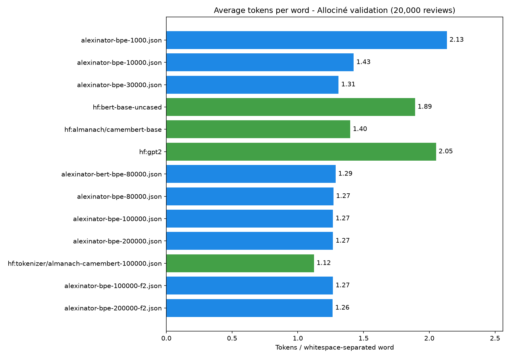

# Tokenizer

Ce document présente le dossier [`tokenizer/`](../tokenizer/) : à quoi sert un tokenizer, comment le nôtre
est entraîné et mesuré, et ce que montrent les résultats. Le détail de chaque fonction est dans les docstrings
des scripts. Les commandes sont dans la section [Lancer les scripts](#lancer-les-scripts).

> **Ni le jeu ni le fine-tuning n'utilisent ce tokenizer.** Un LLM pré-entraîné ne marche qu'avec le tokenizer
> de son entraînement, car chaque ID désigne une ligne précise de sa matrice d'embeddings. Le gardien garde donc
> le tokenizer de son modèle de base (`AutoTokenizer` dans `src/alexinator/llm.py`). Le dossier `tokenizer/`
> sert à étudier la tokenization du français et des attaques du jeu, et à comparer un BPE entraîné par nous à
> des tokenizers existants.

## Ce que fait un tokenizer

Un LLM ne lit pas du texte : il lit une suite d'IDs entiers. Le tokenizer passe du texte aux IDs, et des IDs au
texte. Exemple réel avec `alexinator-bpe-200000-f2.json` :

```
"Titanic est sorti en 1997."
  tokens : ['titanic', 'Ġest', 'Ġsorti', 'Ġen', 'Ġ1997', '.']
  IDs    : [28834, 322, 1411, 310, 12873, 18]
```

L'ensemble des tokens connus forme le vocabulary. Sa taille, `vocab_size`, fixe le nombre de lignes de la
matrice d'embeddings du modèle. Choisir cette taille demande un compromis :

- **plus de tokens** : les tokens sont plus longs, donc un texte en demande moins. Il tient plus de texte dans
  la context window, et la génération demande moins d'étapes ;
- **moins de tokens** : la matrice d'embeddings est plus petite, et chaque token apparaît assez souvent dans les
  données pour être bien appris.

Dans notre jeu, la tokenization compte aussi parce que les attaques déforment les titres : « T-I-T-A-N-I-C »,
« cinatit » (à l'envers), emojis. Le modèle reçoit alors des tokens sans rapport avec ceux du titre (voir
[Exemples de découpage](#exemples-de-découpage)).

## Le pipeline d'un tokenizer

Avec la bibliothèque Hugging Face `tokenizers`, un tokenizer est une chaîne de composants :

```
encodage : texte -> normalizer -> pre-tokenizer -> model -> post-processor -> IDs
décodage : IDs -> decoder -> texte
```

| Composant | Rôle |
| --- | --- |
| normalizer | Nettoie le texte avant le découpage (casse, accents, Unicode) |
| pre-tokenizer | Coupe le texte en « mots ». Un token ne dépasse jamais un mot |
| model | Découpe chaque mot en tokens du vocabulaire (BPE, Unigram, WordPiece...). Seule partie apprise |
| post-processor | Ajoute des special tokens autour du texte (`[CLS] ... [SEP]` pour BERT) |
| decoder | Reconstruit le texte à partir des tokens |

Le dossier contient trois pipelines :

| | Notre BPE | Variante BERT | CamemBERT réentraîné |
| --- | --- | --- | --- |
| Script | `tokenizer.py` | `tokenizer-bert.py` | `tokenizer.py --from-pretrained` |
| normalizer | `NFD` + `Lowercase` + `StripAccents` | idem | `Precompiled` (SentencePiece), garde casse et accents |
| pre-tokenizer | `ByteLevel` (regex de GPT-2) | `BertPreTokenizer` | `WhitespaceSplit` + `Metaspace` |
| model | BPE | BPE | Unigram |
| post-processor | aucun | aucun | `<s> ... </s>` |
| Token inconnu | impossible | `[UNK]` pour un caractère jamais vu | `<unk>` pour un caractère jamais vu |
| `decode(encode(x))` | `x` en minuscules et sans accents | tokens séparés par des espaces | `x`, sauf espaces multiples et caractères inconnus |

### Normalizer : minuscules et sans accents

`NFD` sépare chaque lettre de son accent, `Lowercase` passe en minuscules, puis `StripAccents` retire les accents.
« Amélie », « amélie » et « AMELIE » donnent donc les mêmes tokens. Il y a moins de variantes à apprendre, mais
l'information est perdue :

```
"J'ai adoré Amélie à Paris !"  ->  decode  ->  "j'ai adore amelie a paris !"
```

### Pre-tokenizer `ByteLevel`

Le pre-tokenizer `ByteLevel` (celui de GPT-2) fait deux choses :

1. Il écrit le texte en octets UTF-8, avec un caractère imprimable par octet. L'espace devient `Ġ` ; « 🚢 »
   (4 octets) devient `ðŁ`, `ļ` et `¢`. Avec les 256 octets dans le vocabulaire, tout texte s'encode, et aucun
   token inconnu n'est possible.
2. Il coupe en mots avec une regex qui sépare lettres, chiffres et ponctuation. Chaque espace reste collée au mot
   qui la suit.

Effets visibles dans les rapports :

- `add_prefix_space=False` : le premier mot du texte n'a pas d'espace devant. « quel » en début de texte
  (ID 1170) et « Ġquel » après une espace (ID 544) sont deux tokens différents ;
- l'apostrophe est séparée : « j'ai » donne `j`, `'` et `ai`, et « l'histoire » donne `Ġl`, `'` et `histoire`.
  Les élisions coûtent donc 3 tokens, alors qu'elles sont très fréquentes en français (voir
  [Résultats](#résultats)).

### Model BPE : comment le vocabulaire est appris

Le `BpeTrainer` apprend le vocabulaire sur le corpus :

1. Le pre-tokenizer découpe le corpus en mots, et le trainer compte chaque mot.
2. Chaque mot est écrit avec les symboles de départ : ici les 256 octets (`initial_alphabet`).
3. Le trainer compte les paires de symboles voisins, en tenant compte de la fréquence des mots.
4. La paire la plus fréquente devient un nouveau token : c'est un **merge** (par exemple `Ġ` + `d` donne `Ġd`).
5. Il recommence les étapes 3 et 4 jusqu'à `vocab_size` tokens, ou jusqu'à ce qu'aucune paire n'apparaisse
   `min_frequency` fois.

Pour encoder un mot, le tokenizer rejoue les merges dans l'ordre où ils ont été appris. Le fichier JSON contient
`model.vocab` (token vers ID) et `model.merges` (liste ordonnée). Exemple avec `alexinator-bpe-1000-f3.json` :

| IDs | Contenu |
| --- | --- |
| 0 à 4 | special tokens : `[UNK]`, `[CLS]`, `[SEP]`, `[PAD]`, `[MASK]` |
| 5 à 260 | les 256 symboles d'octets |
| 261 à 999 | 739 merges, dans l'ordre d'apprentissage : `Ġd`, `es`, `en`, `Ġl`, `Ġp`... |

Les special tokens reprennent les noms de BERT, un modèle encoder. Le pipeline n'a pas de post-processor : ils
sont réservés dans le vocabulaire, mais l'encodage ne les ajoute jamais. Un LLM génératif utilise plutôt des
tokens de début et de fin de message (`<|im_start|>` et `<|im_end|>` chez Qwen).

### `vocab_size` et `min_frequency`

`vocab_size` est un **maximum**. Le trainer s'arrête plus tôt quand plus aucune paire n'apparaît `min_frequency`
fois dans le corpus :

| Fichier | `vocab_size` demandé | `min_frequency` | Vocabulaire obtenu |
| --- | --- | --- | --- |
| `alexinator-bpe-100000-f3.json` | 100 000 | 3 | 99 252 |
| `alexinator-bpe-200000-f3.json` | 200 000 | 3 | 99 252 (fichier identique) |
| `alexinator-bpe-100000-f2.json` | 100 000 | 2 | 100 000 |
| `alexinator-bpe-200000-f2.json` | 200 000 | 2 | 123 367 |

Avec `min_frequency = 3`, Allociné ne permet pas plus de 99 252 tokens. Avec `min_frequency = 2`, des paires vues
seulement deux fois deviennent des tokens (fautes de frappe, noms propres rares).

## Les fichiers du dossier

| Fichier | Rôle |
| --- | --- |
| [`tokenizer.py`](../tokenizer/tokenizer.py) | Entraîne notre BPE. Avec `--from-pretrained`, réentraîne un tokenizer du Hub |
| [`tokenizer-bert.py`](../tokenizer/tokenizer-bert.py) | Variante avec `BertPreTokenizer`, pour isoler l'effet du pre-tokenizer |
| [`tokenizer_test.py`](../tokenizer/tokenizer_test.py) | Benchmark d'un tokenizer sur la validation Allociné. Écrit un rapport dans `tests/`. Ce n'est pas un test pytest |
| [`plot_token_counts.py`](../tokenizer/plot_token_counts.py) | Trace trois graphiques à partir de tous les rapports |
| `alexinator-*.json`, `almanach-camembert-*.json` | Tokenizers entraînés, au format JSON de `tokenizers` |
| `tests/*.txt` | Un rapport par tokenizer mesuré |
| `*.png` | Les graphiques de `plot_token_counts.py` |

**Noms des fichiers.**

- Tokenizer : `alexinator-bpe-{vocab_size demandé}-f{min_frequency}.json`. Le nom est écrit à la main dans la
  constante `OUTPUT` : il faut le changer en même temps que `VOCAB_SIZE` et `MIN_FREQUENCY`.
- Rapport : `{nom du tokenizer}-vocab-{vocabulaire obtenu}.txt`. Par exemple,
  `alexinator-bpe-100000-f3-vocab-99252.txt` : 100 000 tokens demandés, 99 252 obtenus.
- Le `-f3` de `almanach-camembert-100000-f3.json` et des rapports des tokenizers du Hub (`gpt2-f3-...`,
  `bert-base-uncased-f3-...`) ne correspond à aucun réglage. `train_pretrained` ne transmet pas `min_frequency`,
  et les tokenizers du Hub n'ont pas été entraînés par nous.

## Lancer les scripts

Depuis la racine du projet. Les scripts lisent Allociné en streaming depuis le Hub : il faut une connexion internet.

```bash
uv sync --only-group tokenizer   # ou --all-groups pour avoir aussi le jeu

# Entraîner notre BPE (réglages : VOCAB_SIZE, MIN_FREQUENCY et OUTPUT dans tokenizer/tokenizer.py)
uv run --only-group tokenizer python tokenizer/tokenizer.py
# Entraîner la variante BertPreTokenizer
uv run --only-group tokenizer python tokenizer/tokenizer-bert.py
# Réentraîner un tokenizer du Hub sur Allociné (transformers n'est pas dans le groupe tokenizer)
uv run --only-group tokenizer --with transformers python tokenizer/tokenizer.py \
    --from-pretrained almanach/camembert-base --vocab-size 100000

# Mesurer un tokenizer (par défaut tokenizer/alexinator-bpe-200000-f2.json)
uv run --only-group tokenizer python tokenizer/tokenizer_test.py
uv run --only-group tokenizer python tokenizer/tokenizer_test.py tokenizer/alexinator-bpe-30000-f3.json
uv run --only-group tokenizer python tokenizer/tokenizer_test.py hf:gpt2

# Refaire les graphiques (--group et non --only-group : matplotlib est dans le groupe app)
uv run --group tokenizer python tokenizer/plot_token_counts.py
```

`tokenizer-bert.py` doit être lancé comme un fichier : son `from tokenizer import ...` charge alors
`tokenizer/tokenizer.py`, et non le package `tokenizer/`.

Pour utiliser un tokenizer entraîné en Python :

```python
from tokenizers import Tokenizer

tok = Tokenizer.from_file("tokenizer/alexinator-bpe-200000-f2.json")
enc = tok.encode("Titanic est sorti en 1997.")
enc.tokens           # ['titanic', 'Ġest', 'Ġsorti', 'Ġen', 'Ġ1997', '.']
enc.ids              # [28834, 322, 1411, 310, 12873, 18]
tok.decode(enc.ids)  # 'titanic est sorti en 1997.'
```

## Le benchmark

`tokenizer_test.py` encode les 20 000 critiques du split `validation` d'Allociné. Les tokenizers sont entraînés
sur le split `train`, donc ces critiques n'ont jamais été vues. Il mesure :

- **Tokens/word**, la fertility : le nombre moyen de tokens par mot. Les mots sont ceux de `str.split()`
  (séparés par les espaces). Ce découpage est le même pour tous les tokenizers, donc les valeurs se comparent.
  Plus la fertility est basse, plus le texte est compact ;
- **Tokens/review** : le nombre moyen de tokens par critique ;
- **[UNK] tokens** : le nombre de tokens inconnus, c'est-à-dire de caractères perdus.

L'encodage se fait avec `add_special_tokens=False` : on ne compte pas les `[CLS]` / `[SEP]` ou `<s>` / `</s>` du
post-processor.

Les rapports ont deux formats. Les plus anciens contiennent aussi des exemples de découpage, une comparaison
français / anglais et le nombre de tokens de titres déguisés. Cette partie a été retirée de
`tokenizer_test.py` au commit `80f6acb`. Les deux formats ont les lignes que lit `plot_token_counts.py`.

## Résultats

Mesures sur les 20 000 critiques de validation (1 849 998 mots) :

| Tokenizer | Appris sur | Vocabulaire | Tokens/word | Tokens/review | Tokens inconnus |
| --- | --- | --- | --- | --- | --- |
| `alexinator-bpe-1000-f3` | Allociné | 1 000 | 2,13 | 197,4 | 0 |
| `alexinator-bpe-10000-f3` | Allociné | 10 000 | 1,43 | 131,9 | 0 |
| `alexinator-bpe-30000-f3` | Allociné | 30 000 | 1,31 | 121,2 | 0 |
| `alexinator-bpe-80000-f3` | Allociné | 80 000 | 1,27 | 117,6 | 0 |
| `alexinator-bpe-100000-f3` (= `200000-f3`) | Allociné | 99 252 | 1,27 | 117,2 | 0 |
| `alexinator-bpe-100000-f2` | Allociné | 100 000 | 1,27 | 117,2 | 0 |
| `alexinator-bpe-200000-f2` | Allociné | 123 367 | 1,26 | 117,0 | 0 |
| `alexinator-bert-bpe-80000-f3` | Allociné | 80 000 | 1,29 | 119,1 | 11 |
| `almanach-camembert-100000-f3` (CamemBERT réentraîné) | Allociné | 100 000 | **1,12** | 103,9 | non compté |
| `almanach/camembert-base` | français (OSCAR) | 32 005 | 1,40 | 129,4 | non compté |
| `bert-base-uncased` | anglais | 30 522 | 1,89 | 175,0 | 46 |
| `gpt2` | anglais | 50 257 | 2,05 | 189,8 | aucun possible (byte-level) |

« Non compté » : `tokenizer_test.py` cherche le token inconnu sous le nom `[UNK]`, mais CamemBERT appelle le sien
`<unk>`. Le rapport affiche 0 sans avoir compté, alors que le CamemBERT réentraîné encode bien « 🚢 » en
`<unk>`, par exemple.



Les graphiques [`vocabulary_sizes.png`](../tokenizer/vocabulary_sizes.png) et
[`letters_per_token.png`](../tokenizer/letters_per_token.png) donnent la taille du vocabulaire et le nombre moyen
de lettres par token. En vert, les rapports dont la source commence par `hf:`. Le CamemBERT réentraîné
apparaît en vert, alors qu'il a été réentraîné chez nous : son rapport commence par `hf:tokenizer/...`.

**Ce qu'on en retient.**

1. **Agrandir le vocabulaire rapporte de moins en moins.** De 1 000 à 10 000 tokens, la fertility baisse de 33 %.
   De 10 000 à 30 000, de 8 %. De 30 000 à 80 000, de 3 %. Au-delà, de moins de 1 %. Les tokens ajoutés sont
   des mots rares qui raccourcissent à peine les textes, alors que la matrice d'embeddings grossit.
2. **Un tokenizer appris sur l'anglais coûte cher en français.** GPT-2 demande 2,05 tokens par mot, contre 1,31
   pour notre BPE de 30 000 tokens. Ses exemples le montrent : « é » s'écrit avec deux octets, réunis dans un
   token `é` qui ne fusionne pas avec les lettres voisines. « adoré » donne ainsi `Ġad`, `or` et `é`. Sur
   quatre paires de phrases, GPT-2 utilise 1,79 token par mot en français et 1,16 en anglais. Notre BPE de
   123 367 tokens fait l'inverse : 1,15 en français et 1,26 en anglais.
3. **CamemBERT réentraîné bat notre BPE à taille égale** (1,12 contre 1,27), alors qu'il garde la casse et les
   accents. Une cause est visible : son pre-tokenizer ne coupe qu'aux espaces, donc « J'ai » forme un seul token
   `▁J'ai`, contre 3 tokens chez nous. L'algorithme (Unigram contre BPE) diffère aussi : ce benchmark ne sépare
   pas les deux effets. Un pre-tokenizer qui garde les élisions est une piste pour améliorer notre BPE.
4. **Le pre-tokenizer `ByteLevel` est meilleur que `BertPreTokenizer`** à 80 000 tokens : il produit moins de
   tokens (1,27 contre 1,29), aucun token inconnu (contre 11), et un décodage fidèle au texte normalisé.
5. **Les comparaisons favorisent nos tokenizers.** Ils sont appris et mesurés sur le même dataset, Allociné, donc
   sur le même type de texte. Ils retirent aussi la casse et les accents, ce que ne font ni GPT-2 ni CamemBERT.

## Exemples de découpage

Découpages de `alexinator-bpe-30000-f3` et `alexinator-bpe-200000-f2` (identiques sur ces textes), et du
rapport de `gpt2` :

| Texte | Notre BPE | GPT-2 |
| --- | --- | --- |
| `Titanic` | 1 token : `titanic` | 3 tokens : `T`, `itan`, `ic` |
| `Titanik` | 3 tokens : `tit`, `ani`, `k` | 3 tokens |
| `cinatit` | 3 tokens : `cin`, `at`, `it` | 3 tokens : `cin`, `at`, `it` |
| `T-I-T-A-N-I-C` | 13 tokens : une lettre ou un tiret chacun | 13 tokens |
| `J'ai adoré Amélie à Paris !` | 8 tokens | 12 tokens |

Pour notre BPE, « Titanic » est un seul token, et ses versions déguisées ne partagent aucun token avec lui.
Un modèle doit donc retrouver le titre à partir de morceaux sans rapport avec le token d'origine. C'est une des
raisons pour lesquelles épeler ou inverser un titre peut tromper un LLM.

## Points d'attention

- **La normalisation n'est pas réversible.** Un modèle qui utiliserait ce tokenizer ne pourrait écrire ni
  majuscule ni accent. Pour un LLM génératif, il faudrait un normalizer qui garde le texte (`NFC` seul, par
  exemple).
- **`[UNK]` est le seul nom de token inconnu reconnu** par `tokenizer_test.py` (voir [Résultats](#résultats)).
- **`OUTPUT` est écrit à la main.** `tokenizer-bert.py` écrit toujours `alexinator-bert-bpe-80000.json`, même
  avec les réglages actuels de `tokenizer.py` (200 000 tokens, `min_frequency = 2`).
- **`local_corpus()` n'est pas encore écrit** et renvoie `None`. Il doit ajouter des textes du projet au corpus.
  Pour l'instant, tous les tokenizers sont appris sur Allociné seul.
- **`tokenizer_test.py` n'est pas un test**, mais pytest le collecte (motif `*_test.py`). Ses imports lourds
  (`tokenizers`, `datasets`) sont faits dans les fonctions. Sans cela, `python -m pytest` échouerait sans le
  groupe `tokenizer`.

## Glossaire

| Terme | Sens |
| --- | --- |
| token | Unité de texte que voit le modèle : un mot, un morceau de mot, un signe ou un octet |
| tokenizer | Outil qui découpe le texte en tokens et les convertit en IDs (et l'inverse) |
| vocabulary, `vocab_size` | Ensemble des tokens connus, et leur nombre |
| embedding | Vecteur appris pour chaque token. La matrice d'embeddings a `vocab_size` lignes |
| context window | Nombre maximal de tokens qu'un LLM traite d'un coup |
| BPE (Byte-Pair Encoding) | Algorithme qui construit le vocabulaire en fusionnant les paires de symboles les plus fréquentes |
| merge | Une fusion apprise par BPE : deux tokens voisins remplacés par un nouveau token |
| Unigram | Autre algorithme (celui de CamemBERT) : part d'un grand vocabulaire et retire les tokens les moins utiles |
| normalizer | Composant qui nettoie le texte avant le découpage |
| pre-tokenizer | Composant qui coupe le texte en mots avant le model |
| post-processor | Composant qui ajoute des special tokens autour du texte encodé |
| decoder | Composant qui reconstruit le texte à partir des tokens |
| byte-level | Travail sur les octets UTF-8 et non sur les caractères : tout texte s'encode sans token inconnu |
| special tokens | Tokens réservés, jamais découpés, qui portent un rôle (`[PAD]`, `[UNK]`, début ou fin de séquence) |
| `[UNK]` / `<unk>` | Token inconnu : remplace ce que le vocabulaire ne sait pas écrire. Le texte d'origine est perdu |
| fertility | Nombre moyen de tokens par mot |
| fast tokenizer | Tokenizer de `transformers` écrit en Rust (bibliothèque `tokenizers`), le seul qui se réentraîne |
| split | Partie d'un dataset : `train` pour l'entraînement, `validation` pour la mesure |
| streaming | Lecture d'un dataset ligne par ligne, sans le télécharger en entier |
